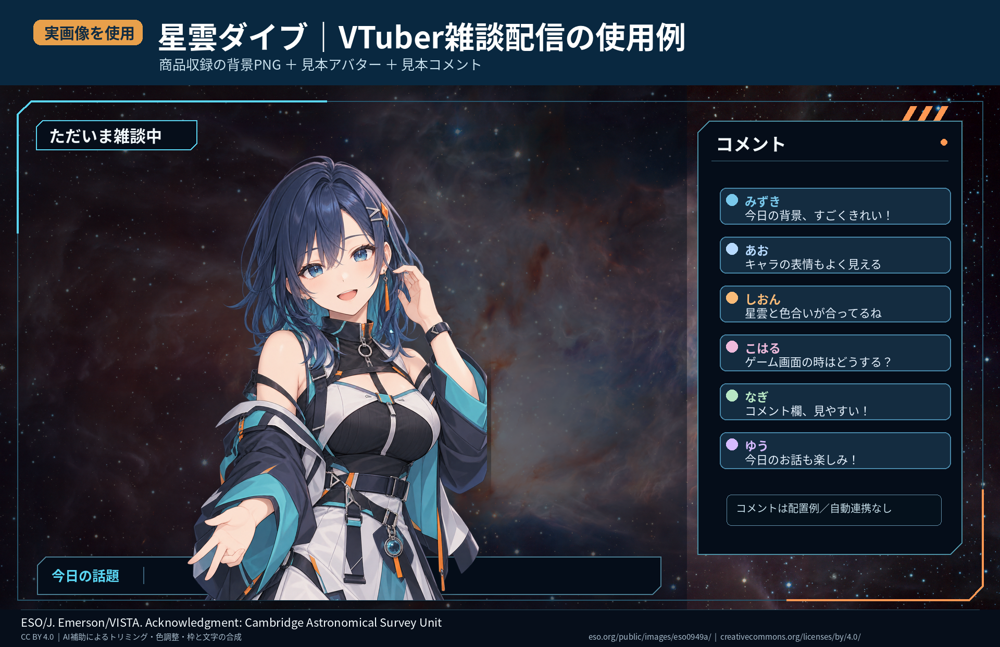
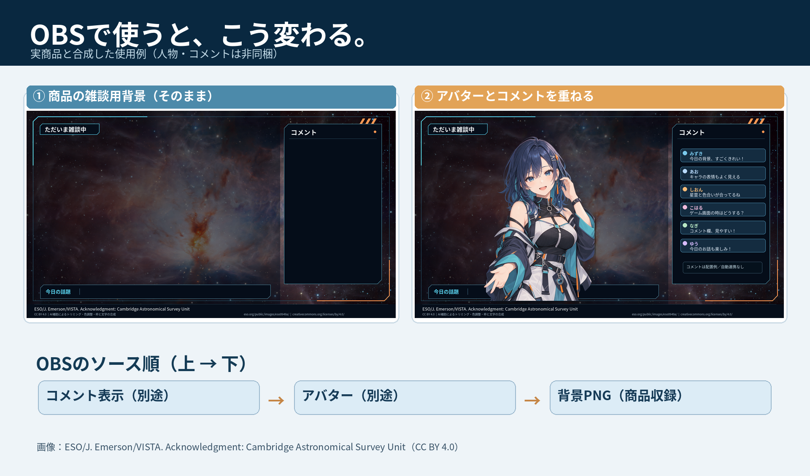

# OBSでVTuber配信背景を入れる — 雑談・ゲーム配信の配置ガイド

> **Yohaku Libraryの無料ガイド** / 2026年10月19日
>
> 対象商品：**星雲ダイブ｜SF・ゲーム配信用画面セット（300円、無料版あり）**。実際の配信背景の合成使用例を準備中です。
>
> PNGの配信背景を読み込んだあと、**立ち絵やコメントが隠れないようにする**実用的な設定手順です。製品の機能を誇張しないため、以下の配置図は模式図であり、有料素材の実画像ではありません。

## 最初に、無料サンプルで配置を試す

**[星雲ダイブ 配信画面セット：無料試用・有料版の確認（BOOTH）](https://yohaku-library.booth.pm/items/8984852?utm_source=github&utm_medium=referral&utm_campaign=booth_sales_engine_02&utm_content=obs_guide_markdown_top)**

背景は見た目だけでなく、立ち絵・コメントと重ねた際の見やすさが重要です。無料試用で雰囲気や表示を確認し、必要な場合のみ有料版の収録内容をご覧ください。商品価格・配布内容・利用条件はBOOTH掲載内容が優先です。

## 実際の「星雲ダイブ」を使った完成イメージ

下の画像は、商品収録の雑談配信背景PNGを元にして、アバターと見本のチャット文を合成したものです。**アバター・コメント自動表示機能は商品に含まれません。**

## 1. OBSで背景画像を読み込む

1. OBS Studioの「シーン」欄で **＋** を押し、「雑談」などのシーンを作る。
2. 「ソース」欄の **＋ → 画像** を選び、使う背景PNGを追加する。
3. 背景画像を選択して **編集 → 変換 → 画面に合わせる** を試し、キャンバスの中に整える。
4. アバター／立ち絵、コメント表示を**別ソース**で追加する。
5. ソース一覧の上にある項目ほど画面の手前に表示される。背景が人物を隠さないよう順番を整理する。

根拠：[OBS Sources Guide](https://obsproject.com/kb/sources-guide) / [OBS Image Sources](https://obsproject.com/kb/image-sources)

## 2. 雑談配信 — 立ち絵を大きく見せる

以下は**仮の位置関係**です。特定の商品を実際に読み込んだスクリーンショットではありません。

| 背景画像の上に重ねるもの | 目安 |
|---|---|
| 立ち絵・アバター | 画面の左〜中央寄り。目・口をコメントで隠さない |
| コメント枠 | 画面の右側。文字が背景と同化しないようにする |
| 配信背景PNG | 最も下のソース。人物より前に置かない |

**OBSの重なり順（上から下へ）：**

1. コメント表示
2. アバター／立ち絵
3. 背景PNG

### 見やすさの確認

- 画面を縮小しても人物の顔が主役になっているか。
- コメント欄の背後が明るすぎたり、細かな模様で読みにくくなっていないか。
- 背景側の小物が立ち絵の顔・手と不自然に重なっていないか。

## 3. ゲーム配信 — ゲーム画面を背景で隠さない

汎用的な表示順は次のとおりです。

1. コメント・アバター
2. 透過オーバーレイ（**商品に付属している場合のみ**）
3. ゲームキャプチャ
4. 背景PNG

> **注意：** 透明部分のない背景画像をゲーム映像の上に重ねると、ゲームが見えなくなります。透過用素材の有無は商品ごとに確認してください。配信背景の購入で、自動コメント取得などの機能が付くとは限りません。

ゲームの大事なUI、字幕、HPなどを立ち絵で隠さないよう、実際のゲーム映像で調整します。

## 4. 配信直前のチェック

| 症状 | 最初の確認 |
|---|---|
| アバターが背景の後ろに隠れる | 「ソース」の上下順 |
| 背景が見切れる | キャンバス比率、画像サイズ、「画面に合わせる」 |
| コメントが読みにくい | 文字と背景のコントラスト、枠の不透明度 |
| ゲーム画面が消える | 不透明な背景がゲームキャプチャより上にないか |
| 配信中に意図しないものが映る | 短いローカル録画で実際の出力を確認する |

[OBS公式Quick Start Guide](https://obsproject.com/kb/quick-start-guide)では本番前のテスト録画を案内しています。

## 5. 自分の配信に合うか、無料版で判断する

**[Yohaku Library「星雲ダイブ 配信画面セット」— BOOTHで無料試用を見る](https://yohaku-library.booth.pm/items/8984852?utm_source=github&utm_medium=referral&utm_campaign=booth_sales_engine_02&utm_content=obs_guide_markdown_bottom)**

気に入った場合は商品ページで有料版との差、ファイル形式、使用条件をご確認ください。購入を前提にせず無料サンプルから試せます。

---

このページは **Yohaku Library自身による無料の使い方資料** です。BOOTHまたはOBSの公式ガイドではありません。画面例は汎用の説明用であり、販売商品の実物画像ではありません。個々の素材の権利表示・加工条件は各商品の案内を確認してください。